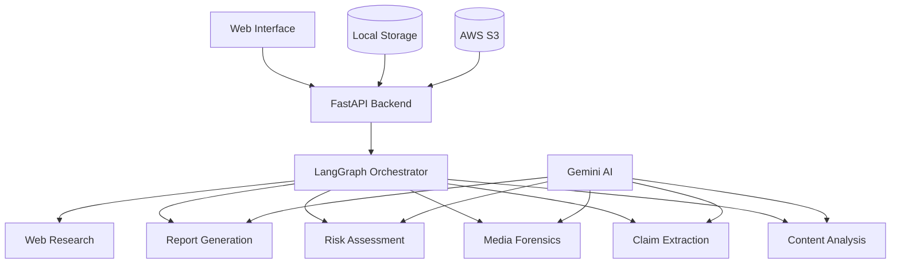

# 🔍 SeeSure: AI-Powered Social Media Content Verification

<div align="center">


**Intelligent Social Media Content Analysis & Risk Assessment Platform**

[](https://www.python.org/downloads/)
[](https://fastapi.tiangolo.com)
[](LICENSE)
[](CONTRIBUTING.md)

[🚀 Quick Start](#quick-start) • [📖 Documentation](#documentation) • [🎯 Demo](#demo) • [🔧 API Reference](#api-reference) • [🤝 Contributing](#contributing)

</div>

---

## 🌟 What is SeeSure?

**SeeSure** is an advanced AI-powered platform designed to analyze social media content for authenticity, misinformation detection, and risk assessment. Simply upload a screenshot of any social media post, and SeeSure provides comprehensive intelligence reports with actionable insights.

### ✨ Key Capabilities

🔍 **Content Analysis** - OCR text extraction and semantic understanding  
🎯 **Claim Detection** - Identify and extract verifiable factual claims  
🔬 **Media Forensics** - Detect potential image manipulation indicators  
🌐 **Web Research** - Cross-reference claims with authoritative sources  
📊 **Risk Scoring** - Generate explainable risk assessments (0-100 scale)  
📋 **Intelligence Reports** - Professional, human-readable analysis summaries  

---

## 🚀 Quick Start

### 📋 Prerequisites

- Python 3.8 or higher
- Google Gemini API key (free tier available)
- Modern web browser

### ⚡ One-Command Setup

```bash
# 1. Test your system
python test_installation.py

# 2. Start backend
python start_backend.py

# 3. Start frontend (new terminal)
python start_frontend.py
```

**That's it!** 🎉 Open http://localhost:8080 and start analyzing content.

### 🎯 Try It Now

1. Run `python create_demo_image.py` to generate test images
2. Upload `demo_images/iphone_offer.png` in the web interface
3. Watch SeeSure analyze suspicious pricing claims in real-time
4. Review the comprehensive intelligence report

---

## 🏗️ Architecture Overview

<div align="center">



</div>

## 🛠️ Technology Stack

### Frontend
- **Pure Web Technologies**: HTML5, CSS3, Vanilla JavaScript
- **No Dependencies**: Works in any modern browser
- **Responsive Design**: Desktop and mobile friendly

### Backend  
- **FastAPI**: High-performance Python web framework
- **LangGraph**: AI workflow orchestration
- **Pydantic**: Data validation and serialization
- **Uvicorn**: ASGI server for production deployment

### AI & Intelligence
- **Google Gemini**: Vision AI for OCR and content analysis
- **Custom Algorithms**: Risk assessment and forensics detection
- **Web Research**: Real-time claim verification
- **Multi-Modal Analysis**: Text, image, and metadata processing

### Storage & Infrastructure
- **Flexible Storage**: Local filesystem or AWS S3
- **Scalable Architecture**: Microservice-ready design
- **Cloud Native**: Docker and Kubernetes compatible

---

## 📁 Project Structure

```
seesure/
├── 🎨 frontend/                 # Web interface
│   ├── index.html              # Main application UI
│   ├── style.css               # Responsive styling
│   └── script.js               # Interactive functionality
├── 🧠 backend/                 # FastAPI backend
│   ├── api/                    # REST API endpoints
│   │   ├── analyze.py          # Analysis workflow endpoints
│   │   └── reports.py          # Report generation endpoints
│   ├── agents/                 # AI analysis agents
│   │   ├── content_agent.py    # Content understanding
│   │   ├── claim_agent.py      # Claim extraction
│   │   ├── media_agent.py      # Media forensics
│   │   ├── research_agent.py   # Web research
│   │   ├── risk_agent.py       # Risk assessment
│   │   └── report_agent.py     # Report generation
│   ├── graph/                  # LangGraph workflow
│   │   ├── workflow.py         # Analysis orchestration
│   │   └── state.py            # Workflow state management
│   ├── services/               # Core services
│   │   ├── vision_service.py   # AI vision processing
│   │   ├── research_service.py # Web search integration
│   │   ├── storage_service.py  # File storage abstraction
│   │   └── sentiment_service.py# Sentiment analysis
│   └── models/                 # Data models
│       └── schemas.py          # Pydantic schemas
├── 🔧 Configuration
│   ├── .env.example           # Environment template
│   ├── requirements.txt       # Python dependencies
│   └── start_*.py            # Launch scripts
└── 📚 Documentation
    ├── README.md             # This file
    ├── QUICKSTART.md         # Quick setup guide
    └── API.md                # API documentation
```

---

## 🔧 Configuration

### 🔑 Environment Variables

Create a `.env` file from the template:

```bash
# 🚨 REQUIRED: AI Services
GEMINI_API_KEY=your_gemini_api_key_here

# ☁️ OPTIONAL: Cloud Storage
AWS_ACCESS_KEY_ID=your_aws_access_key
AWS_SECRET_ACCESS_KEY=your_aws_secret_key
AWS_REGION=us-east-1
S3_BUCKET_NAME=seesure-storage

# 🔍 OPTIONAL: Enhanced Research
SEARCH_API_KEY=your_web_search_api_key

# 📊 OPTIONAL: Monitoring
LANGSMITH_API_KEY=your_langsmith_api_key

# ⚙️ Application Settings  
DEMO_MODE=false                    # Enable for offline demo
LOG_LEVEL=INFO                     # DEBUG, INFO, WARNING, ERROR
MAX_IMAGE_SIZE_MB=10              # Upload size limit
```

### 🎯 Getting API Keys

#### Google Gemini API (Required)
1. Visit [Google AI Studio](https://aistudio.google.com/)
2. Create a new API key (free tier: 15 requests/minute)
3. Add to `.env` as `GEMINI_API_KEY`

#### AWS S3 (Optional - Enhanced Storage)
1. Create AWS account and IAM user
2. Generate access keys with S3 permissions
3. Create S3 bucket for file storage

#### Web Search API (Optional - Enhanced Research)
1. Choose provider: Bing Search API, SerpAPI, or Serper
2. Get API credentials
3. Add as `SEARCH_API_KEY`

---

## 📊 Analysis Workflow

SeeSure employs a sophisticated multi-stage analysis pipeline:

### 🔄 Stage 1: Content Ingestion
- **Image Validation**: Format, size, and security checks
- **Storage**: Secure upload to local or cloud storage
- **Preprocessing**: Image optimization and metadata extraction

### 🔍 Stage 2: Content Understanding  
- **OCR Processing**: Advanced text extraction using Gemini Vision
- **Content Classification**: Social media platform detection
- **Entity Recognition**: People, places, brands, products
- **Topic Analysis**: Subject matter categorization

### 🎯 Stage 3: Claim Analysis
- **Claim Detection**: Identify verifiable factual statements
- **Entity Extraction**: Named entities within claims
- **Value Parsing**: Prices, dates, quantities, percentages
- **Verification Needs**: Determine research requirements

### 🔬 Stage 4: Parallel Intelligence Gathering
**Media Forensics Thread:**
- Manipulation indicators detection
- AI generation artifact analysis
- Visual consistency assessment
- Technical authenticity scoring

**Sentiment Analysis Thread:**
- Emotional tone assessment
- Promotional language detection
- Bias and manipulation indicators
- Confidence scoring

**Web Research Thread:**
- Query generation and optimization
- Multi-source information gathering
- Source credibility assessment
- Evidence categorization

### ⚖️ Stage 5: Risk Assessment
- **Multi-factor Analysis**: Claims, sources, forensics, sentiment
- **Scoring Algorithm**: 0-100 risk scale with explanations
- **Risk Categorization**: LOW, MEDIUM, HIGH, CRITICAL
- **Confidence Metrics**: Assessment reliability indicators

### 📋 Stage 6: Report Generation
- **Executive Summary**: Key findings overview
- **Evidence Analysis**: Supporting/contradicting information
- **Risk Breakdown**: Detailed factor explanation
- **Action Recommendations**: Next steps for analysts
- **Source Attribution**: Transparent research citations

---

## 🔗 API Reference

### Core Endpoints

#### `POST /api/analyze`
**Start Content Analysis**
```bash
curl -X POST "http://localhost:8000/api/analyze" \
  -F "image=@suspicious_post.png"
```

**Response:**
```json
{
  "analysis_id": "SS-2024-000042",
  "status": "processing",
  "message": "Analysis started successfully"
}
```

#### `GET /api/analyze/{analysis_id}`
**Check Analysis Progress**
```bash
curl "http://localhost:8000/api/analyze/SS-2024-000042"
```

**Response:**
```json
{
  "analysis_id": "SS-2024-000042",
  "status": "completed",
  "progress": 100,
  "report_url": "/api/report/SS-2024-000042"
}
```

#### `GET /api/report/{analysis_id}`
**Retrieve Intelligence Report**

Returns comprehensive analysis including:
- Content analysis and extracted text
- Identified claims and entities
- Sentiment assessment
- Media authenticity indicators  
- Research findings and sources
- Risk score and recommendations

### Status Flow
```
received → validating → uploaded → extracting → analyzing → 
researching → verifying → generating_report → completed
```

---

## 🎯 Demo Mode

Perfect for testing without external API dependencies:

```bash
# Enable in .env
DEMO_MODE=true

# Generate test images
python create_demo_image.py

# Start application
python start_backend.py
```

**Demo Features:**
- ✅ Full UI functionality
- ✅ Realistic analysis simulation
- ✅ Sample intelligence reports
- ✅ Risk assessment examples
- ⚠️ Clearly labeled demo data

---

## 🔒 Security & Privacy

### Data Protection
- **Local Processing**: Images analyzed locally by default
- **No Data Retention**: Files deleted after analysis (configurable)
- **Secure APIs**: All external API calls use HTTPS
- **Input Validation**: Comprehensive file security checks

### Privacy Features
- **No User Tracking**: No personal data collection
- **Optional Cloud**: S3 storage is optional, local storage default
- **API Key Security**: Environment-based credential management
- **Audit Logs**: Complete analysis trails for compliance

### Production Security Checklist
- [ ] Enable rate limiting
- [ ] Add authentication/authorization
- [ ] Configure CORS properly
- [ ] Set up HTTPS/TLS
- [ ] Implement input sanitization
- [ ] Add request validation
- [ ] Configure logging and monitoring

---

## 📈 Performance & Scalability

### Current Capacity
- **Analysis Time**: 15-45 seconds per image
- **Concurrent Users**: 10-20 (single instance)
- **Image Size**: Up to 10MB supported
- **Formats**: PNG, JPEG, WEBP

### Scaling Options

#### Horizontal Scaling
```yaml
# Docker Compose example
version: '3.8'
services:
  seesure-api:
    build: .
    replicas: 3
    environment:
      - REDIS_URL=redis://redis:6379
  redis:
    image: redis:7-alpine
  nginx:
    image: nginx:alpine
    # Load balancer configuration
```

#### Performance Optimizations
- **Async Processing**: FastAPI + asyncio
- **Image Optimization**: Automatic resizing and compression
- **Caching**: Redis for repeated analyses
- **CDN Integration**: Static asset delivery
- **Database**: PostgreSQL for persistence

---

## 🧪 Testing

### Automated Testing
```bash
# Install test dependencies
pip install pytest pytest-asyncio httpx

# Run full test suite
pytest tests/ -v

# Run with coverage
pytest --cov=backend tests/
```

### Manual Testing
```bash
# System health check
curl http://localhost:8000/api/health

# Upload test image
curl -X POST "http://localhost:8000/api/analyze" \
  -F "image=@demo_images/iphone_offer.png"

# Check analysis status
curl "http://localhost:8000/api/analyze/SS-2024-000001"
```

### Load Testing
```bash
# Install siege
sudo apt install siege  # Ubuntu/Debian
brew install siege      # macOS

# Test API endpoints
siege -c 10 -r 5 http://localhost:8000/api/health
```

---

## 🚀 Deployment Options

### Development
```bash
# Quick local setup
python start_backend.py    # Terminal 1
python start_frontend.py   # Terminal 2
```

### Production (Docker)
```dockerfile
# Dockerfile
FROM python:3.11-slim
WORKDIR /app
COPY requirements.txt .
RUN pip install -r requirements.txt
COPY backend/ ./backend/
CMD ["uvicorn", "backend.main:app", "--host", "0.0.0.0", "--port", "8000"]
```

```bash
# Build and run
docker build -t seesure:latest .
docker run -p 8000:8000 --env-file .env seesure:latest
```

### Cloud Deployment
- **AWS**: ECS, Lambda, or EC2
- **Google Cloud**: Cloud Run, GKE, or Compute Engine  
- **Azure**: Container Instances, AKS, or App Service
- **Heroku**: Direct Git deployment
- **DigitalOcean**: App Platform or Droplets

---

## 🔧 Troubleshooting

### Common Issues

#### "Backend Unavailable"
```bash
# Check if backend is running
curl http://localhost:8000/api/health

# Check logs
tail -f backend/logs/seesure.log

# Restart backend
python start_backend.py
```

#### "Analysis Failed"  
```bash
# Check API keys in .env
grep GEMINI_API_KEY .env

# Enable debug logging
echo "LOG_LEVEL=DEBUG" >> .env

# Try demo mode
echo "DEMO_MODE=true" >> .env
```

#### "Image Upload Error"
- Verify image format (PNG, JPEG, WEBP)
- Check file size (< 10MB)
- Ensure proper file permissions
- Try different image

### Performance Issues
```bash
# Check system resources
top
df -h

# Monitor API performance
curl -w "@curl-format.txt" -s -o /dev/null http://localhost:8000/api/health

# Check network connectivity
ping google.com
```

---

## 🤝 Contributing

We welcome contributions! Here's how to get started:

### Development Setup
```bash
# Clone repository
git clone https://github.com/yourorg/seesure.git
cd seesure

# Create virtual environment
python -m venv venv
source venv/bin/activate  # or `venv\Scripts\activate` on Windows

# Install development dependencies
pip install -r requirements-dev.txt

# Install pre-commit hooks
pre-commit install
```

### Contribution Guidelines
1. **Fork** the repository
2. **Create** a feature branch: `git checkout -b feature/amazing-feature`
3. **Commit** your changes: `git commit -m 'Add amazing feature'`
4. **Push** to the branch: `git push origin feature/amazing-feature`  
5. **Open** a Pull Request

### Code Standards
- **Python**: Follow PEP 8, use Black formatter
- **JavaScript**: Use ESLint and Prettier
- **Documentation**: Update README for new features
- **Testing**: Add tests for all new functionality

---

## 📄 License

This project is licensed under the MIT License - see the [LICENSE](LICENSE) file for details.

---

## 🙏 Acknowledgments

- **Google AI**: Gemini API for vision and language processing
- **LangChain**: Framework for AI application development
- **FastAPI**: Modern, fast web framework for building APIs
- **Community**: Open source contributors and testers

---

## 📞 Support & Community

### Get Help
- 📖 **Documentation**: Check this README and [API docs](API.md)
- 🐛 **Issues**: [GitHub Issues](https://github.com/yourorg/seesure/issues)
- 💬 **Discussions**: [GitHub Discussions](https://github.com/yourorg/seesure/discussions)
- 📧 **Email**: support@seesure.ai

### Community Resources
- 🌟 **Star** this repo if SeeSure helps you!
- 🐦 **Follow** [@SeeSureAI](https://twitter.com/seesureai) for updates
- 📱 **Join** our [Discord community](https://discord.gg/seesure)
- 📝 **Blog**: [seesure.ai/blog](https://seesure.ai/blog) for tutorials

---

<div align="center">

**Made with ❤️ by the SeeSure team**

[⭐ Star on GitHub](https://github.com/yourorg/seesure) • [🐛 Report Bug](https://github.com/yourorg/seesure/issues) • [💡 Request Feature](https://github.com/yourorg/seesure/issues)

</div>